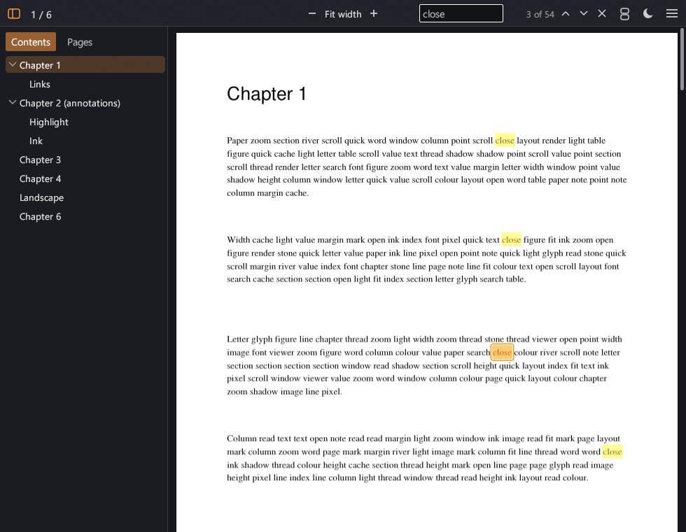

# Recto


*recto* (n.): the right-hand page of an open book.

A lightweight, quick-starting PDF viewer for Windows, written in Rust. It opens a PDF
with the first page already sharp, scrolls smoothly through files with thousands of
pages, and keeps the window to the page: one slim bar, no toolbar wall. It only views:
nothing in a PDF is ever changed.



## Why I made it

Finding a good PDF viewer is a known problem: most are slow to open, lag when you scroll
through a big file, or bury the page under toolbars, sign-in prompts and features you
never use. I wanted one that opens instantly, stays smooth on long documents and scans,
and is easy to use with the mouse or the keyboard. Recto is that viewer. It is the fourth
of my small Windows replacements, after the [Glance](https://github.com/TheSnapped/Glance)
video player, the [Kerf](https://github.com/TheSnapped/Kerf) video editor and the
[Earshot](https://github.com/TheSnapped/Earshot) music player, and it can be set as the
Windows default.

## Download

Get **`Recto-<version>-windows-x64.zip`** from the [Releases page](https://github.com/TheSnapped/Recto/releases/latest),
unzip it somewhere permanent (for example `C:\Tools\Recto`) and run `recto.exe`.
It's a single exe: nothing is installed and no admin rights are needed.
Requires Windows 10/11 (64-bit).

### Make it your default PDF viewer

Open the menu (the three lines at the top right) > **Set Recto as default PDF viewer**,
or run `recto.exe --register`. Windows then opens **Settings > Default apps**: choose
**Recto** for `.pdf` files (on Windows 10, scroll to "Choose default apps by file type").
Windows doesn't let apps make themselves the default, so this click is needed.
`recto.exe --unregister` undoes it.

## Features

- **Opens instantly.** The file is read while the window is still being created, so
  the first page is sharp in the very first frame.
- **Big files stay smooth.** Only the pages in view (and the next ones) are rendered,
  on background threads, with a quick low-resolution version first. 800-page books and
  100 MB scans scroll without stutter, and an idle window uses no CPU.
- **Continuous scrolling or single pages**, zoom from 8 % to 800 %, fit width and fit page.
- **Search** with every match highlighted, starting from the page you're on.
- **Select and copy text**: drag over it, double-click a word, triple-click a line.
- **Contents and thumbnails** in a sidebar that follows along as you read.
- **Dark pages**: colours inverted while keeping their hues, for reading at night.
- **Links**: jumps inside the document (Alt+Left takes you back) and web links.
  Links that would run programs on your PC (file:, custom protocols...) are not opened.
- **Annotations** in the PDF (highlights, notes, ink, stamps, form contents) are shown.
- **Printing** through the normal Windows print dialog, any printer.
- **Password-protected PDFs** ask for the password.
- Drag a PDF onto the window to open it.

Recto is strictly a viewer: no annotating, no form filling, no signing, no saving.
Each window shows one document and nothing is remembered about individual files.

## Controls

| Action | Keys / mouse |
|---|---|
| Scroll | Mouse wheel, `j` / `k`, Up / Down, drag empty space or with the middle button |
| A screen down / up | Space / Shift+Space, PageDown / PageUp |
| Next / previous page | `J` / `K`, Left / Right (when the page fits the width) |
| First / last page | `g` / `G`, Home / End |
| Go to page | Type the number, then `G` or Enter (`12G`), or Ctrl+G, or click the page number |
| Back / forward after a link | Alt+Left / Alt+Right |
| Zoom | `+` / `-`, Ctrl+wheel, `0` = 100 % |
| Fit width / fit page | `w` / `f`, or click the zoom percentage |
| Continuous / single page | `c` |
| Search | `/` or Ctrl+F; Enter, `n` or F3 = next match, Shift+Enter, `N` or Shift+F3 = previous |
| Select text | Drag over it; double-click = word, triple-click = line |
| Copy / select the page's text | Ctrl+C / Ctrl+A |
| Dark pages | `i` |
| Contents and thumbnails | `t` |
| Open / print | Ctrl+O / Ctrl+P |
| Full screen | F11 (Esc leaves) |
| All shortcuts | F1 |

### Command line

```
recto.exe document.pdf              open a file
recto.exe document.pdf --page 42    open it at page 42 (also -p 42 or --page=42)
recto.exe --register                register as a PDF viewer (see above)
recto.exe --unregister              remove that registration
```

Each call opens its own window, so other programs (an editor, a script) can open a PDF
at a given page.

Settings (window size and position, dark pages, sidebar, page layout) are stored in
`%APPDATA%\Recto\settings.ini`.

## How it works

[MuPDF](https://mupdf.com) parses and renders the PDFs. It is compiled into the exe, so
there are no DLLs. Two or three worker threads each open their own copy of the document
and take the most urgent job the UI currently wants: the visible pages first (a quick
thumbnail-sized version, then the full one), then the text and links of those pages, then
the pages just ahead. Finished pages are kept in a memory budget that drops the ones seen
longest ago. Search runs on its own thread with another copy, so it never holds up
rendering. Printing renders each page at the printer's resolution and sends it through
Windows' GDI. The UI is [egui](https://github.com/emilk/egui), drawn with OpenGL, and the
window only redraws when something changes.

Fonts a PDF names without embedding (Arial, Calibri, Japanese and Chinese fonts...) are
taken from Windows' own fonts.

## Building

Needs:
- Rust (MSVC toolchain)
- Visual Studio 2019 or 2022 with "Desktop development with C++" (MSBuild compiles MuPDF)
- LLVM, for libclang and clang-cl: `winget install LLVM.LLVM` (the paths are set in `.cargo\config.toml`)

```
.\build.ps1      # builds dist\ (recto.exe + MuPDF's license); the first build takes a few minutes
.\package.ps1    # builds, then zips ..\releases\Recto-<version>-windows-x64.zip
cargo run --release -- <file.pdf>
```

MuPDF comes from the [`mupdf`](https://crates.io/crates/mupdf) crate (MuPDF 1.27). Three
workarounds for its 0.8.0 release live in this repo, each marked to remove once fixed upstream:
`patches/mupdf` is the published crate with a one-line fix for MSVC, `build/static-crt.props`
builds MuPDF for the static C runtime (like the exe), and `.cargo\config.toml` compiles the
crate's small C wrapper with clang-cl.

`RELEASE-README.txt` becomes the README inside the release zip. The icon is generated by
`python assets/make_icon.py`.

For testing:
- `RECTO_TIMING=<file>` appends when the first frame and the first page appeared
  (milliseconds after process start); `RECTO_EXIT=1` then closes the window.
- `cargo build --release --features script` builds a test version that replays input from
  the file named by `RECTO_SCRIPT` and saves screenshots (see `src/script.rs`).
  It isn't part of normal builds.

## Made with AI

Recto was built with the help of AI: the code was written together with Claude (Anthropic)
in Claude Code, directed, tested and reviewed by me.

## License

Recto is licensed under the [GNU General Public License v3.0 or later](LICENSE).

Release builds include [MuPDF](https://mupdf.com) by Artifex Software, which is licensed
under the GNU Affero General Public License v3.0 (see `MUPDF-LICENSE.txt`); its source code
is at https://github.com/ArtifexSoftware/mupdf. MuPDF in turn includes FreeType, HarfBuzz,
libjpeg, OpenJPEG, jbig2dec, Little CMS, zlib, Gumbo and the URW base fonts under their
own licenses.
